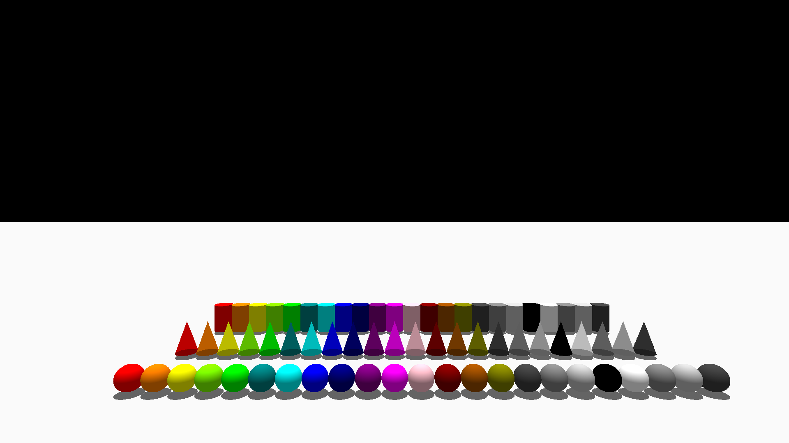
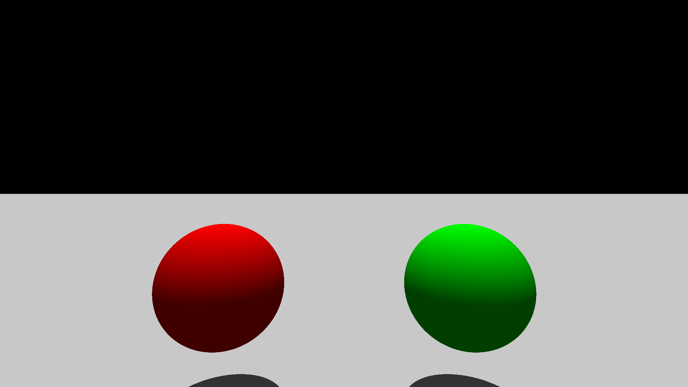

# RAYTRACER



### Development

By *Marin Jeunot*(marin.jeunot@epitech.eu), *Evans Ramin*(evans.ramin@epitech.eu) & *Sacha Lemée*(sacha.lemee@epitech.eu).

## Objective

- "*Ray tracing is a technique used to generate realistic digital images by simulating the inverse path of light. Your goal is to create a program able to generate an image from a file describing the scene*"
[RAYTRACER EPITECH Subject](doc/G-OOP-400_raytracer.pdf)

## Features

- Modular architecture
- Scene parsing from `.cfg`
- Ray tracing renderer

### Design Patterns

- Builder pattern
- Factory pattern

### Supported Primitives

- Sphere
- Plane
- Cylinder
- Cone

### Lighting System

- Ambient light
- Directional light

### Materials

- Flat color

## Getting Started

### Prerequisites

This project requires:
- C++20
- CMake 3.20+
- clang++ 20.1.8

*No external graphics library is required.*

### Installation for Linux

1. **Clone the repository:**

```sh
git clone git@github.com:EpitechPGE2-2025/G-OOP-400-PAR-4-1-raytracer-29.git
```

2. **Navigate to the project directory:**

```sh
cd G-OOP-400-PAR-4-1-raytracer-29.git
```

3. **Build the project:**

```sh
cmake -S . -B build
cmake --build build
```

4. **Run the raytracer:**

```sh
./raytracer <SCENE_FILE>
```

Example:
```sh
./raytracer scenes/room_spheres_v1.cfg
```



## Repository Architecture

See the complete repository architecture here: [RAYTRACER Project structure](doc/PROJECT_STRUCTURE.md)


## Documentation

See the full documentation here : [RAYTRACER Documentation](doc/DOCUMENTATION.md)

## License

This project is licensed under the **MIT License**.


