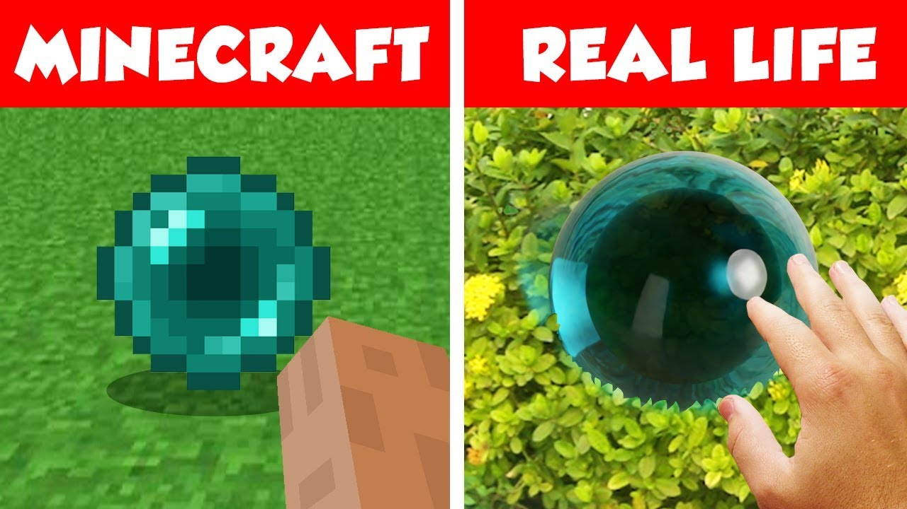

# RAYTRACER



### Development

By *Marin Jeunot*(marin.jeunot@epitech.eu), *Evans Ramin*(evans.ramin@epitech.eu) & *Sacha Lemée*(sacha.lemee@epitech.eu).

## Objective

- "*Ray tracing is a technique used to generate realistic digital images by simulating the inverse path of light. Your goal is to create a program able to generate an image from a file describing the scene*"
[RAYTRACER EPITECH Subject](doc/G-OOP-400_raytracer.pdf)

## Getting Started

### Prerequisites

This project requires the following dependencies:

- **Programming Language:** C++

## Requirements

- clang++ version 20.1.8
- **Libraries:** sfml 2.6.1

### Installation for Linux

1. **Clone the repository:**

```sh
git clone git@github.com:EpitechPGE2-2025/G-OOP-400-PAR-4-1-raytracer-29.git
```

2. **Navigate to the project directory:**

```sh
cd G-OOP-400-PAR-4-1-raytracer-29.git
```

3. **install dependencies:**

```sh
sudo apt-get install libsfml-dev
```

Want to learn more ? Check out the [SFML Documentation](https://www.sfml-dev.org/) !

4. **lauch project:**
```sh
cmake -S . -B build
cmake --build build
./raytracer <SCENE_FILE>
```

## Documentation

See [RAYTRACER Documentation](doc/DOCUMENTATION.md)

## License

This project is licensed under the **MIT License**.


