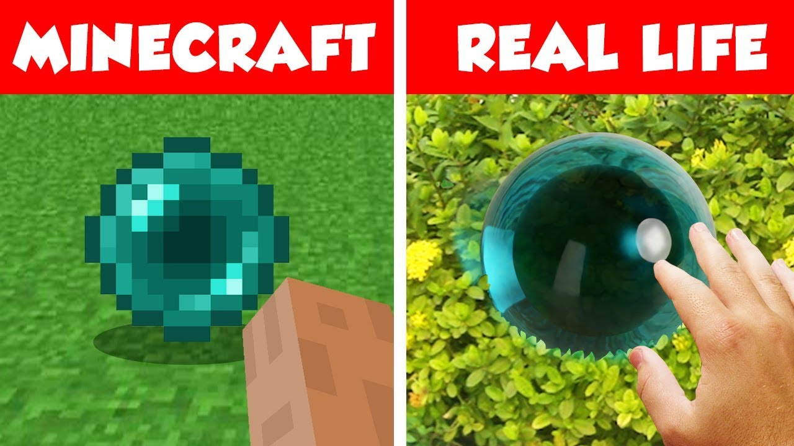

# Documentation - Raytracer

## Introduction

Ce Raytracer supporte les primitives 3D (sphères, plans, cylindres, cônes), les matériaux (couleur unie, textures, miroirs, transparence) et l'éclairage (ambient, diffus, directionnel).

## Tutoriels

### [Comment ajouter une nouvelle primitive ?](TUTO_PRIMITIVES.md)
Tutoriel complet pour implémenter une primitive.

### [Comment ajouter un nouveau matériau ?](TUTO_MATERIALS.md)
Tutoriel pour créer des matériaux personnalisés.

