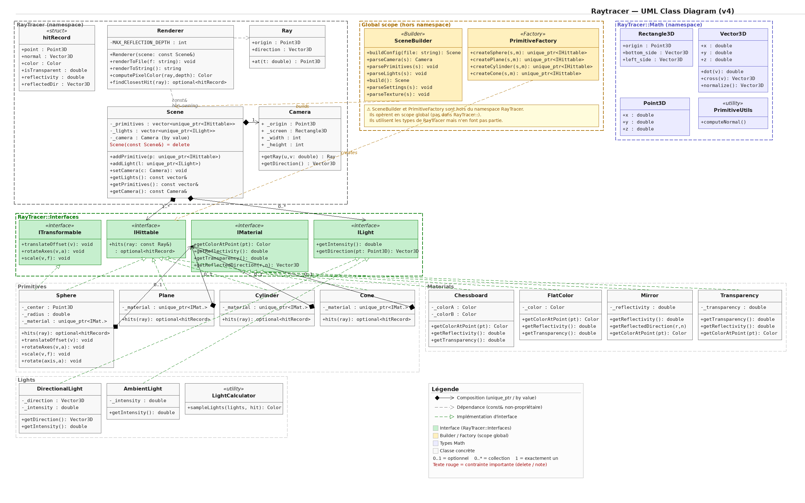

```text
.
├── CMakeCache.txt
├── CMakeFiles
├── cmake_install.cmake
├── CMakeLists.txt
├── compile_flags.txt
├── doc
│   ├── DOCUMENTATION.md
│   ├── G-OOP-400_raytracer_bootstrap_cpp.pdf
│   ├── G-OOP-400_raytracer.pdf
│   ├── Minecraft-vs-RealLife.png
│   ├── PROJECT_STRUCTURE.md
│   ├── TUTO_MATERIALS.md
│   └── TUTO_PRIMITIVES.md
├── include
│   ├── Colors.hpp
│   ├── Exceptions
│   │   └── Exception.hpp
│   ├── Factory
│   │   ├── PrimitiveFactory.hpp
│   │   └── SceneBuilder.hpp
│   ├── Interfaces
│   │   ├── IHittable.hpp
│   │   ├── ILight.hpp
│   │   ├── IMaterial.hpp
│   │   └── ITransformable.hpp
│   ├── Lights
│   │   ├── AmbientLight.hpp
│   │   ├── DirectionalLight.hpp
│   │   └── LightCalculator.hpp
│   ├── Materials
│   │   ├── Chessboard.hpp
│   │   ├── FlatColor.hpp
│   │   ├── Mirror.hpp
│   │   ├── TextureFromFile.hpp
│   │   └── Transparency.hpp
│   ├── Math
│   │   ├── Point3D.hpp
│   │   └── Vector3D.hpp
│   ├── Primitives
│   │   ├── Cone.hpp
│   │   ├── Cylinder.hpp
│   │   ├── Plane.hpp
│   │   ├── PrimitiveUtils.hpp
│   │   └── Sphere.hpp
│   ├── RayTracer
│   │   ├── Camera.hpp
│   │   ├── Ray.hpp
│   │   ├── Rectangle3D.hpp
│   │   ├── Renderer.hpp
│   │   └── Scene.hpp
│   ├── RayTracer.hpp
│   └── Templates
│       └── Template.hpp
├── LICENSE
├── Makefile
├── README.md
├── scenes
│   ├── room_all_primitives.cfg
│   ├── room_all_primitives_mirror.cfg
│   ├── room_chessboard.cfg
│   ├── room_cones_v1.cfg
│   ├── room_cones_v2.cfg
│   ├── room_cylinders_v1.cfg
│   ├── room_scene_mirror.cfg
│   ├── room_spheres_v1.cfg
│   ├── room_spheres_v2.cfg
│   ├── room_spheres_v3.cfg
│   └── room_transparency.cfg
├── screenshots
│   ├── room_all_primitives_mirror_1920x1080.png
│   ├── room_all_primitives_mirror_3840x1600.png
│   ├── room_all_primitives.png
│   ├── room_chessboard.png
│   ├── room_cones_v1.png
│   ├── room_cones_v1v2.png
│   ├── room_cones_v2.png
│   ├── room_cylinders_v1.png
│   ├── room_cylinders_v1v2.png
│   ├── room_scene_mirror.png
│   ├── room_spheres_v1.png
│   ├── room_spheres_v2.png
│   ├── room_spheres_v3.png
│   ├── room_transparency.png
├── src
│   ├── ErrorHandling
│   │   └── errorHandling.cpp
│   ├── Exceptions
│   │   └── RaytracerException.cpp
│   ├── Factory
│   │   ├── PrimitiveFactory.cpp
│   │   └── SceneBuilder.cpp
│   ├── Interfaces
│   │   └── IMaterial.cpp
│   ├── Lights
│   │   ├── AmbientLight.cpp
│   │   ├── DirectionalLight.cpp
│   │   └── LightCalculator.cpp
│   ├── main.cpp
│   ├── Materials
│   │   ├── Chessboard.cpp
│   │   ├── Colors.cpp
│   │   ├── FlatColor.cpp
│   │   ├── Mirror.cpp
│   │   ├── TextureFromFile.cpp
│   │   └── Transparency.cpp
│   ├── Math
│   │   ├── Point3D.cpp
│   │   ├── Vector3D.cpp
│   ├── Primitives
│   │   ├── Cone.cpp
│   │   ├── Cylinder.cpp
│   │   ├── Plane.cpp
│   │   ├── PrimitiveUtils.cpp
│   │   └── Sphere.cpp
│   └── Raytracer
│       ├── Camera.cpp
│       ├── Ray.cpp
│       ├── Rectangle3D.cpp
│       ├── Renderer.cpp
│       └── Scene.cpp
└── textures
    ├── brick.jpg
    ├── idk.jpg

59 directories, 218 files
```