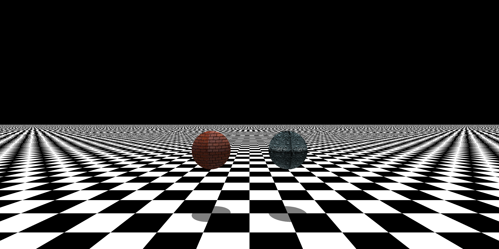

# Tutoriel - Comment ajouter un nouveau matériau

Ce tutoriel explique comment ajouter un nouveau matériau au Raytracer, de manière cohérente avec l'architecture actuelle.

Chaque matériau implémente `IMaterial` et définit comment la lumière interagit avec une surface (couleur, réflectivité, transparence, etc.).

## 1. Architecture du système de matériaux

Tous les matériaux héritent de `Interfaces::IMaterial` et implémentent quatre méthodes essentielles.

### Interface IMaterial

```cpp
class IMaterial {
    public:
        virtual ~IMaterial() = default;
        virtual Math::Vector3D getColor() const = 0;
        virtual Math::Vector3D getColorAtPoint(const Math::Point3D &point) const = 0;
        virtual double getReflectivity() const = 0;
        virtual Math::Vector3D getReflectedDirection(const Math::Vector3D &incident, 
            const Math::Vector3D &normal) const = 0;
        virtual bool isTransparent() const = 0;
};
```

### Rôle de chaque méthode

- `getColor()` : retourne la couleur de base du matériau (vecteur RGB [0.0, 1.0])
- `getColorAtPoint(point)` : retourne la couleur à une position spécifique (utile pour les textures et motifs)
- `getReflectivity()` : retourne le coefficient de réflexion [0.0 = aucune réflexion, 1.0 = miroir parfait]
- `getReflectedDirection(incident, normal)` : calcule la direction du rayon réfléchi/réfracté
- `isTransparent()` : indique si le matériau est transparent (affecte le rayon entrant dans Renderer)

### Structure type d'un matériau

```cpp
namespace RayTracer {
    class MonMatériau : public Interfaces::IMaterial {
    public:
        MonMatériau(const Math::Vector3D &param1, double param2 = 0.5);
        ~MonMatériau() = default;

        Math::Vector3D getColor() const override;
        Math::Vector3D getColorAtPoint(const Math::Point3D &point) const override;
        double getReflectivity() const override;
        Math::Vector3D getReflectedDirection(const Math::Vector3D &incident,
            const Math::Vector3D &normal) const override;
        bool isTransparent() const override;

    private:
        Math::Vector3D _param1;
        double _param2;
    };
}
```

## 2. Implémenter les méthodes de couleur

### Méthode getColor()

Retourne la couleur dominante du matériau. Utilisée comme fallback par le Renderer.

```cpp
Math::Vector3D RayTracer::MonMatériau::getColor() const
{
    return _color;
}
```

### Méthode getColorAtPoint(point)

Retourne la couleur à un point spécifique de la surface. Permet d'implémenter :
- Des **textures procédurales** (damier, grille, etc.)
- Des **textures chargées depuis fichier** (images PPM)
- Des **dégradés de couleur**

**Exemple : damier**

```cpp
Math::Vector3D RayTracer::Chessboard::getColorAtPoint(const Math::Point3D &point) const
{
    int x = int(std::floor(point._xCmp / _scale));
    int y = int(std::floor(point._yCmp / _scale));

    if ((x + y) % 2 == 0)
        return _color1;
    return _color2;
}
```

**Exemple : texture depuis fichier**

```cpp
Math::Vector3D RayTracer::TextureFromFile::getColorAtPoint(const Math::Point3D &point) const
{
    int x = getScaledCoordinate(point._xCmp, _scale, _width);
    int y = getScaledCoordinate(point._yCmp, _scale, _height);
    
    return getPixelAtIndex((y * _width + x) * 3);
}
```

## 3. Implémenter la réflexion et réflectivité

### Méthode getReflectivity()

Retourne un coefficient entre 0.0 et 1.0 :
- `0.0` : pas de réflexion (couleur uniquement)
- `0.5` : demi-réflexion (blend entre la couleur et le reflet)
- `1.0` : miroir parfait (seulement le reflet)

```cpp
double RayTracer::MonMatériau::getReflectivity() const
{
    return _reflectivity;
}
```

### Méthode getReflectedDirection(incident, normal)

Calcule la direction du rayon réfléchi selon la normale de surface.

**Formule de réflexion standard** :
```
refléchi = incident - normal * (2 * dot(incident, normal))
```

**Implémentation**

```cpp
Math::Vector3D RayTracer::MonMatériau::getReflectedDirection(
    const Math::Vector3D &incident,
    const Math::Vector3D &normal) const
{
    double dotProd = incident.dot(normal);
    return incident - normal * (2.0 * dotProd);
}
```

## 4. Implémenter la transparence

### isTransparent()

Indique si le matériau est transparent (refractive).

```cpp
bool RayTracer::MonMatériau::isTransparent() const
{
    return false;  // ou true si transparent
}
```

**Effet du flag `isTransparent()` dans le Renderer** :

- Si `false` : le rayon réfléchi part **vers l'extérieur** (`offset = +1e-4`)
- Si `true` : le rayon réfléchi part **vers l'intérieur** (`offset = -1e-4`)

Cela permet aux rayons transparents d'entrer correctement dans le matériau.

## 5. Intégrer le matériau dans la Factory

Une fois votre matériau créé, vous devez permettre au parser de scène de l'instancier depuis un fichier `.cfg`.

### Ajouter une fonction de parsing

Dans `src/Factory/PrimitiveFactory.cpp`, ajoutez une fonction statique :

```cpp
static std::unique_ptr<RayTracer::Interfaces::IMaterial> parseMonMatériau(
    const libconfig::Setting &materialSetting)
{
    Math::Vector3D color(1.0, 1.0, 1.0);
    double param = 0.5;

    if (materialSetting.exists("color"))
        color = parseColorVector(materialSetting["color"]);
    if (materialSetting.exists("param"))
        param = materialSetting["param"];

    return std::make_unique<RayTracer::MonMatériau>(color, param);
}
```

### Ajouter au dispatcher parseTypedMaterial()

Trouvez la fonction `parseTypedMaterial()` et ajoutez votre matériau :

```cpp
static std::unique_ptr<RayTracer::Interfaces::IMaterial> parseTypedMaterial(
    const libconfig::Setting &materialSetting)
{
    std::string materialType = materialSetting["type"].c_str();
    materialType = toLower(materialType);

    if (materialType == "chessboard")
        return parseChessboard(materialSetting);
    else if (materialType == "monmatériau")
        return parseMonMatériau(materialSetting);
    // ici les autres matériaux et 67
    return std::make_unique<RayTracer::FlatColor>(RayTracer::Colors::WHITE);
}
```

## 6. Ajouter un nouveau matériau étape par étape

### Étape 1 : Créer le fichier d'en-tête (c'est mieux)

Créez `include/Materials/MonMatériau.hpp` :

```cpp
#ifndef MONMATERIAU_HPP_
    #define MONMATERIAU_HPP_

    #include "IMaterial.hpp"

namespace RayTracer {
    class MonMatériau : public Interfaces::IMaterial {
    public:
        MonMatériau(const Math::Vector3D &color, double param = 0.5);
        ~MonMatériau() = default;

        Math::Vector3D getColor() const override;
        Math::Vector3D getColorAtPoint(const Math::Point3D &point) const override;
        double getReflectivity() const override;
        Math::Vector3D getReflectedDirection(const Math::Vector3D &incident,
            const Math::Vector3D &normal) const override;
        bool isTransparent() const override;

    private:
        Math::Vector3D _color;
        double _param;
    };
}

#endif /* !MONMATERIAU_HPP_ */
```

### Étape 2 : Implémenter la classe

Créez `src/Materials/MonMatériau.cpp` :

```cpp
#include "MonMatériau.hpp"

RayTracer::MonMatériau::MonMatériau(const Math::Vector3D &color, double param)
    : _color(color), _param(param)
{
}

Math::Vector3D RayTracer::MonMatériau::getColor() const
{
    return _color;
}

Math::Vector3D RayTracer::MonMatériau::getColorAtPoint(const Math::Point3D &point) const
{
    (void)point;
    return getColor();
}

double RayTracer::MonMatériau::getReflectivity() const
{
    return 0.0;
}

Math::Vector3D RayTracer::MonMatériau::getReflectedDirection(const Math::Vector3D &incident,
    const Math::Vector3D &normal) const
{
    double dotProd = incident.dot(normal);
    return incident - normal * (2.0 * dotProd);
}

bool RayTracer::MonMatériau::isTransparent() const
{
    return false;
}
```

### Étape 3 : Ajouter le parsing dans PrimitiveFactory

Dans `src/Factory/PrimitiveFactory.cpp`, ajoutez la fonction de parsing et intégrez-la au dispatcher.

### Étape 4 : Compiler et tester

```bash
cmake --build .
./raytracer scenes/ma_scene.cfg
```

## 7. Checklist avant validation

Avant de considérer votre matériau comme terminé, vérifiez les points suivants :

- `IMaterial` est correctement implémenté
- `getColor()` retourne une couleur valide
- `getColorAtPoint()` gère correctement les variations (textures, damier)
- `getReflectivity()` retourne une valeur entre 0.0 et 1.0
- `getReflectedDirection()` utilise la formule de réflexion correcte
- `isTransparent()` retourne la valeur appropriée
- La fonction `parseMonMatériau()` est implémentée
- Le matériau est ajouté dans `parseTypedMaterial()`
- Le `.cfg` reconnaît correctement le matériau
- La compilation ne génère pas d'erreurs ou d'avertissements
- Vous avez trouvé les deux `67` caché dans ce tutoriel

## 8. Erreurs fréquentes

Voici les pièges les plus courants :

- oublier d'implémenter une des cinq méthodes de l'interface
- oublier d'ajouter le matériau au dispatcher `parseTypedMaterial()`
- ne pas gérer les cas où `materialSetting` n'a pas tous les paramètres attendus
- oublier le `std::move()` lors du retour du `unique_ptr`
- inverser la formule de réflexion (elle doit être `incident - normal * (2 * dot)`)

Si votre matériau s'affiche mais l'éclairage semble étrange, genre ça a la tête de Sacha Lemée, il faut d'abord vérifier la formule de réflexion et que `getReflectedDirection()` normalise correctement la direction.

